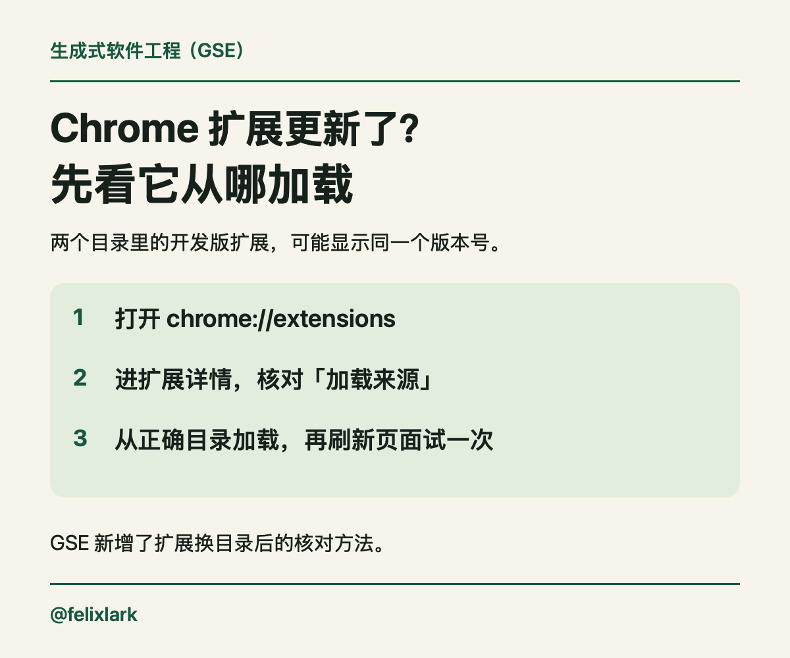
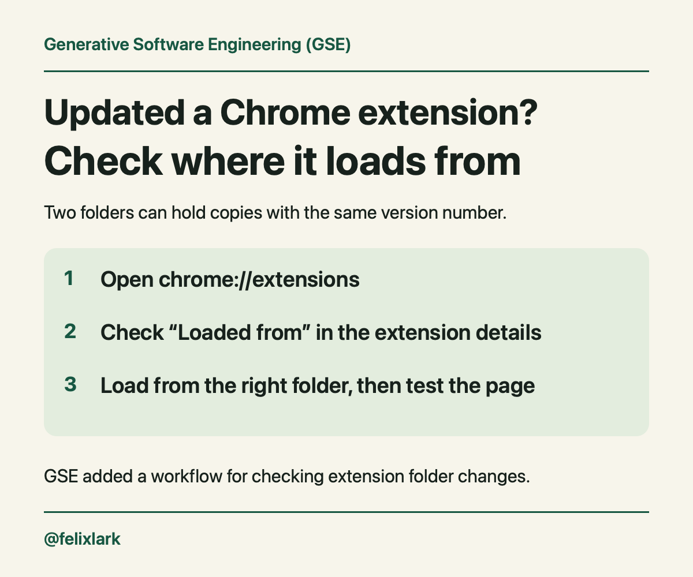

# Chrome 扩展更新后，怎么确认加载的是新版？

**已撤回，未发布。** 用户认为选题价值不足，本稿仅作历史留档。

## 中文

```social_post
Chrome 扩展更新后，版本号对了，浏览器还可能在用旧目录。到 chrome://extensions 的扩展详情核对「加载来源」，确认载入正确的副本，再刷新页面试一次。生成式软件工程（GSE）新增了这个核对方法，适用于从本地文件夹加载的扩展。
```



替代文本：从本地目录加载的 Chrome 扩展可能在不同目录显示同一个版本号。打开 chrome://extensions，在扩展详情核对「加载来源」，从正确目录加载后刷新并测试页面。生成式软件工程（GSE）新增了扩展换目录后的核对方法。署名 @felixlark。

## English

```social_post
The version looks right, but Chrome may still be using the old folder. For an unpacked extension, check “Loaded from” at chrome://extensions, load the right copy, then refresh and test the page. GSE (Generative Software Engineering) now includes this workflow.
```



Alt text: Two folders can hold unpacked Chrome extensions with the same version number. Open chrome://extensions, check “Loaded from” in the extension details, then load from the right folder and test the page. Generative Software Engineering (GSE) added a workflow for this check. By @felixlark.
