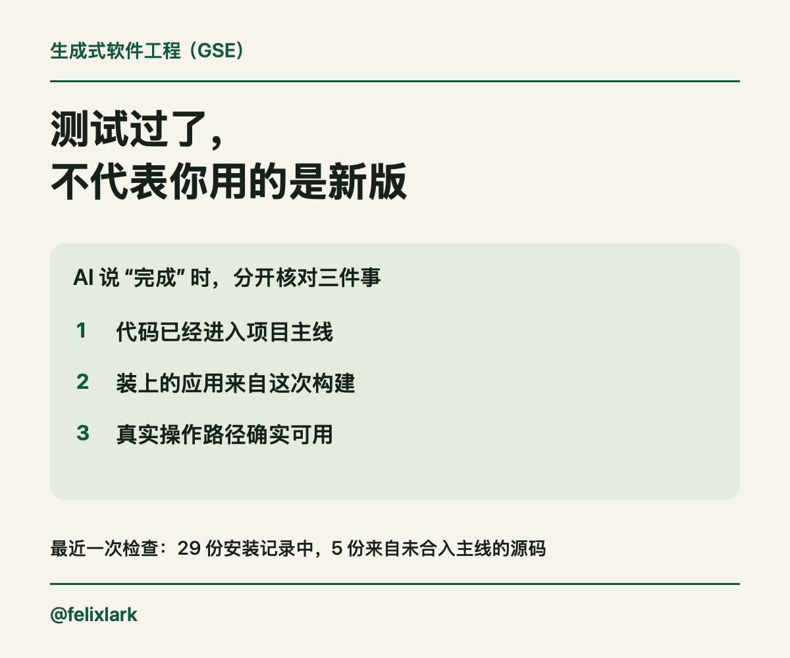
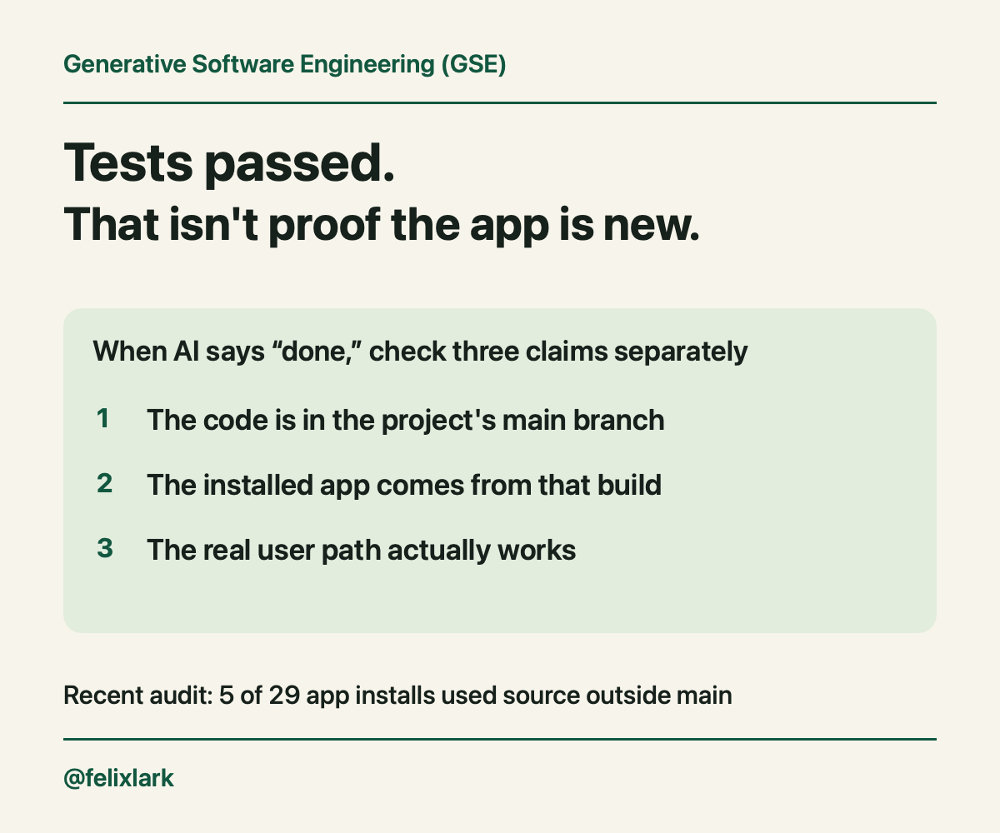

# “修好了”到底算哪一步？

## 中文

```social_post
AI 说“修好了”，你打开应用却还是旧版。测试通过、装上的版本、用户真能用，是三件事。GSE 这次新增工程基线，逐个核对。最近检查的 29 份应用安装记录里，有 5 份来自还没合进项目主线的源码。
```



替代文本：测试通过、安装正确版本和用户真的能用是三件不同的事。生成式软件工程（GSE）新增工程基线，分别核对代码是否进入项目主线、安装的应用是否来自这次代码、真实操作路径是否可用。最近一次检查发现，29 份应用安装记录中有 5 份来自未合入主线的源码。署名 @felixlark。

## English

```social_post
Your AI coding agent says “fixed,” but the app still runs the old build. Tests passing, the right build being installed, and the app actually working are different claims. GSE now checks them separately. In a recent audit, 5 of 29 app installs came from source that had not been merged into main.
```



Alt text: Tests passing, the right build being installed, and the app actually working are different claims. Generative Software Engineering (GSE) now checks whether the code is in the project's main branch, whether the installed app comes from that build, and whether the real user path works. A recent audit found that 5 of 29 app installs came from source outside main. By @felixlark.
